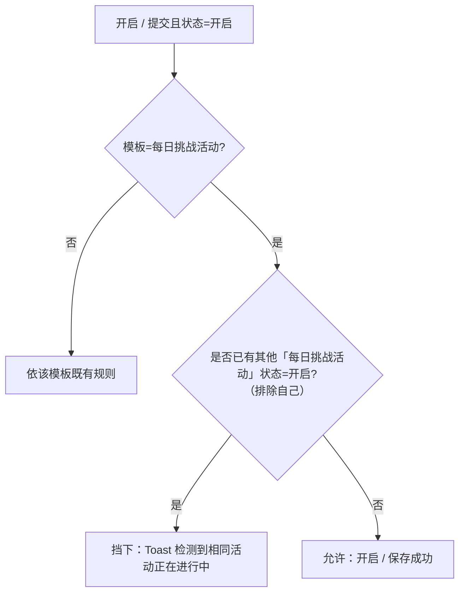

# 每日挑战活动 · 后台需求规格

| 项目 | 内容 |
|---|---|
| 文件版本 | v1.1 |
| 日期 | 2026-11-20 |
| 撰写 | Zaken（PM） |
| 原型图 | 每日挑战活动 · 后台原型 v1.1（Artifact：https://claude.ai/artifact/W5k5qEtK7hh2UC3yTB1FBn） |
| 参考既有功能 | 后台 › 活动配置(新) › 活动列表 › 联名挑战活动（ID 225 现网配置，2026-11-20 检视） |

**本次变更摘要（v1.1）**

- **修改**：移除文件与原型中不适用于本活动的玩法描述与示意资料（原型同步更新为 v1.1）。

**v1.0 摘要**

- **新增**：活动模板「每日挑战活动」（以联名挑战活动为底）。
- **删除**（相对联名挑战活动）：活动条件中的「挑战任务配置」区块，及每日返水表的「挑战任务」栏；相应的预览字段与审核备注中的挑战字样。
- **修改**：同期开启限制改为「每日挑战活动各自限 1 个」，可与联名挑战活动同时开启；前台入口于活动结束时间到即隐藏。

---

## 1. 需求目的

联名挑战活动带有「挑战任务（翻牌加成）」等玩法，配置复杂、只适合联名档期。营运需要一个**可长期常态上架、只保留「每日达标领奖」核心**的轻量活动：用户每天完成有效投注／充值目标即可手动领取固定彩金，次日重新计算。

本需求以联名挑战活动现行后台为底，**复用其活动列表、配置向导、派奖审核、活动报表**，仅移除挑战任务等加成玩法，以降低开发量与营运配置成本。

---

## 2. 变更分类总览

| 分类 | 项目 | 对应页签 |
|---|---|---|
| 新增 | 活动模板下拉选项「每日挑战活动」（列表筛选、配置向导、派奖审核、活动报表） | 4.1 / 4.2.1 / 4.3 / 4.4 |
| 新增 | 每日挑战活动同期开启限制（自身限 1 个，与联名挑战活动互不影响） | 4.1 / 4.2.1 |
| 异动 | 活动条件：移除「挑战任务配置」；每日返水表移除「挑战任务」栏 | 4.2.4 |
| 异动 | 提交预览：移除「挑战任务配置」等不适用字段 | 4.2.6 |
| 异动 | 活动时间说明文案：入口于活动结束时间到即隐藏 | 4.2.1 |
| 不异动 | 活动图片、参与对象与名单、风控条件、通用派奖配置、游戏范围弹窗、列表其余字段 | 4.2.2 / 4.2.3 / 4.2.5 |

**本次未涉及之既有规则**（沿用联名挑战活动，不在本文件重述）

1. 前台活动页样式与领取交互（本次仅交付后台）。
2. 已获得奖励的领取期限与失效规则（沿用联名挑战活动现行规则）。
3. 每日返水的进度计算口径（有效投注／充值的统计来源、每日 00:00 重置时区）。
4. 首页浮窗、Rewards → Promotion 列表的显示与排序规则。
5. 礼金发放、流水倍数计算、风控检测的判定逻辑。
6. 其他活动模板（预约、周卡、节庆特别、联名挑战）的所有规则。

---

## 3. 前台

本次不涉及前台改版。唯一影响：前台入口**于活动时间内显示，活动结束时间到即隐藏**。详见「6. 待确认事项」第 1 点。

---

## 4. 后台

### 4.1 活动列表（对应原型 4.1）

位置：活动配置(新) › 活动列表。

| 元素 | 规则 |
|---|---|
| 模板筛选（新增选项） | 下拉来源：系统活动模板枚举。选项：全选／预约活动／周卡活动／节庆特别活动／联名挑战活动／**每日挑战活动**。预设「全选」。 |
| 活动模板栏 | 显示「每日挑战活动」。 |
| 活动名称栏 | 单行显示，超出宽度以「…」截断，滑过显示完整名称（tooltip）。 |
| 起止时间栏 | 两行显示 `yy/mm/dd`（开始／结束）。 |
| 其余栏位 | 与既有模板一致，不异动。 |
| 无数据 | 筛选结果为空显示「暂无数据」。 |

**操作按钮**

| 按钮 | 显示条件 | 交互 | 成功提示 | 失败提示 |
|---|---|---|---|---|
| 编辑 | 恒显示 | 进入配置向导（编辑模式），带入原配置 | — | — |
| 删除 | 恒显示 | 弹窗「⚠️ 确定要删除此活动吗？删除后该活动将从列表中移除，且无法复原。」→ 确定 | Toast「删除成功」，列表移除该行 | 接口失败：Toast「删除失败，请稍后再试」 |
| 关闭 | 状态＝开启 | 弹窗「⚠️ 关闭后前台入口将隐藏并停止计算新奖励；已获得的奖励依现行规则处理。确定关闭？」→ 确定 | Toast「活动已关闭」，状态改「关闭」、按钮改「开启」 | 接口失败：Toast「操作失败，请稍后再试」 |
| 开启 | 状态＝关闭 | 依「4.5 判断逻辑一」检查同期限制 | Toast「活动已开启」 | Toast「检测到相同活动正在进行中」，状态不变 |

弹窗点「取消」或「×」：关闭弹窗，不做任何变更。

---

### 4.2 配置向导

共 6 步，左侧步骤条与右上「上一步／下一步／提交／退出编辑」按钮沿用既有。

| 交互 | 规则 |
|---|---|
| 下一步 | 校验当前步骤，通过才前进；失败停留并以红框＋Toast 提示。 |
| 上一步 | 不校验，直接回上一步；第 1 步隐藏。 |
| 步骤条点击 | 往前跳不校验；往后跳需先通过当前步骤校验。 |
| 提交 | 仅第 6 步显示。提交前重新校验步骤 1、4，未通过自动跳回该步骤。 |
| 退出编辑 | 直接返回活动列表，不保存；Toast「已退出编辑，未保存任何变更」。 |
| 提交成功 | 新增：Toast「新增成功」，列表最上方插入新行；编辑：Toast「保存成功」，更新原行。返回列表。 |
| 提交失败（接口） | Toast「保存失败，请稍后再试」，停留第 6 步，已填内容保留。 |

#### 4.2.1 活动模板设置（对应原型 4.2.1，异动）

| 字段 | 类型 | 必填 | 限制／规则 |
|---|---|---|---|
| 活动类型 | 下拉 | 是 | 来源：活动模板枚举，新增「每日挑战活动」。**编辑模式不可变更（灰底）**。 |
| 活动名称 | 输入框 | 是 | 1～50 字；不可留空、不可全为空白；输入框下显示字数 `n/50`。列表中超出以「…」截断。 |
| 币种 | 下拉 | 是 | 来源：平台已启用币种（PHP／USD…），预设 PHP。 |
| 状态 | 单选 | — | 关闭（预设）／开启。下方提示文案：「同一时间只能开启一个每日挑战活动（可与联名挑战活动同时开启）。」 |
| 活动时间 | 日期时间区间 | 是 | 结束时间需晚于开始时间。 |

状态开关作用：

| 状态 | 作用 |
|---|---|
| 关闭 | 前台入口隐藏、停止计算新进度与新奖励；已获得奖励依现行规则可领取；重新开启后进度维持（沿用联名挑战）。 |
| 开启 | 活动时间内前台显示入口并开始计算；需通过同期限制检查（4.5 判断逻辑一）。 |

说明文案（橘色）：
- 活动时间到期：停止计算／产生新奖励；已获得的奖励沿用联名挑战活动现行领取规则。
- 前台入口于活动时间内显示，活动结束时间到即隐藏。

失败提示：

| 情境 | 提示 |
|---|---|
| 活动名称空白 | 红框＋Toast「活动名称必填」 |
| 活动时间未选 | 红框＋Toast「活动时间必填」 |
| 结束时间 ≤ 开始时间 | 红框＋Toast「结束时间需晚于开始时间」 |
| 日期选择器只选一端就按确定 | Toast「请选择完整的起止日期」 |

#### 4.2.2 活动图片（对应原型 4.2.2，不异动）

首页浮窗设置（开启／关闭＋PC／H5 图片）、活动列表设置（开启／关闭＋PC／H5 图片）、备注，全部沿用联名挑战活动。图片格式 png、bmp、jpg、gif、webp；5MB 内。

#### 4.2.3 参与对象与名单（对应原型 4.2.3，不异动）

充值层级、指定代理、新会员限制、会员等级、用户标签、黑名单、排除用户标签，全部沿用联名挑战活动。

#### 4.2.4 活动条件（对应原型 4.2.4，异动）

**移除项目**

| 移除 | 说明 |
|---|---|
| 挑战任务配置区块 | 含「新增挑战」按钮、挑战1～5、奖励提升／触发机率／获奖机率及其校验。 |
| 每日返水表「挑战任务」栏 | 原「触发」勾选框。 |

**每日返水配置（必填，保留）**

| 元素 | 规则 |
|---|---|
| VIP 页签 | VIP0～VIP10，各等级各别配置。 |
| 套用至其他等级 | 勾选：其余 VIP 页签灰掉不可点，全部套用 VIP0 配置，并自动切回 VIP0；取消勾选：恢复各等级可编辑。 |
| 新增等级 | 表格末端新增一列（空白）；已达 LV20 时 Toast「等级最多 LV20」。 |
| 等级 | 自动编号 LV1～LV20，删除后自动重排。 |
| 任务条件 | 下拉，来源固定：有效投注（预设）／充值。 |
| 任务目标 | 前缀「≥」；仅可输入正整数（自动过滤小数点、负号、文字）；不可为空、不可为 0。 |
| 奖励物 | 固定显示「彩金」，不可编辑。 |
| 奖励金额 | 前缀「固定金额」；仅可输入正整数；不可为空、不可为 0。 |
| 删除 | 仅剩 LV1 时删除按钮灰掉（至少保留 1 级）。 |

表格下方说明文案：「任务目标／固定金额：不可为空、0 或小数点；任务目标需依同「任务条件」逐级递增（不可小于或等于同任务条件）。奖励金额一律为固定金额。等级最低 LV1，最多 LV20。」

**通用派奖配置（保留，不异动）**

| 字段 | 规则 |
|---|---|
| 彩金所需流水倍数 | 可留空；如填写须为 0.01～999999.99（最多 8 位整数＋2 位小数），不可为 0。 |
| 审核方式 | 固定「自动审核」，不可编辑。 |
| 领取方式 | 固定「手动领取」，不可编辑。 |
| 适用游戏范围 | 必填；按钮显示「已选择 全部 游戏」或「已选择 n 个 游戏」；点击开弹窗，预设全选（含体育）；至少选 1 个。 |

失败提示（按「下一步」时）：

| 情境 | 提示 |
|---|---|
| 任务目标或奖励金额为空／0 | 红框＋Toast「活动条件有必填/格式错误，请检查红框」 |
| 任务目标未依同任务条件递增 | 红框＋格内红字「任务目标不可小于或等于同任务条件」（输入当下即显示）＋Toast「任务目标不可小于或等于同任务条件，请检查红框」 |
| 流水倍数格式不符 | 红框＋Toast「彩金所需流水倍数须为 0.01～999999.99（不可为 0）」 |
| 游戏弹窗一个都没选就按确认 | Toast「请至少选择 1 个游戏」，弹窗不关闭 |

成功提示：游戏弹窗确认 → Toast「已更新适用游戏范围」。

#### 4.2.5 风控条件（对应原型 4.2.5，不异动）

| 开关 | 关闭（预设） | 开启 |
|---|---|---|
| 同IP／同手机号／同姓名／同email检测 | 不检测 | 领奖时检测该项重复 |
| 自动拒绝 | 违规仅标记，不拒绝 | 违反笔数达「触发条件」即自动拒绝 |

联动：四项检测全关时「自动拒绝」区块灰掉不可开；自动拒绝关闭时「触发条件」输入框不可编辑（仅正整数）。

#### 4.2.6 提交预览（对应原型 4.2.6，异动）

| 步骤 | 显示字段 |
|---|---|
| ① 活动模板设置 | 活动ID（新增显示「提交后产生」）、模板类型、状态、币种、活动名称、活动时间 |
| ② 活动图片 | 首页浮窗、活动列表、备注 |
| ③ 参与对象与名单 | 充值层级、指定代理、新会员限制、会员等级、黑名单 |
| ④ 活动条件 | 套用至其他等级、每日返水配置（n 个等级）、彩金所需流水倍数、审核方式、领取方式、适用游戏范围 |
| ⑤ 风控条件 | 四项检测（是／否）、自动拒绝（是（n 笔）／否） |

移除字段：挑战任务配置，以及联名挑战活动专属的期次与展示截止字段。

---

### 4.3 派奖审核（对应原型 4.3，新增选项）

| 元素 | 规则 |
|---|---|
| 活动类型筛选 | 新增选项「每日挑战活动」。 |
| 奖励类型 | 一律「礼金」。 |
| 状态 | 一律「审核通过」。 |
| 审核人 | 一律「自动审核」；审核时间＝申请时间。 |
| 备注 | 格式 `User VIP Level {n}, LV{m} Base Reward {金额}`；不含 Challenge 字样。单行超出以「…」截断。 |

### 4.4 活动报表（对应原型 4.4，新增选项）

**4.4.1 活动奖励统计**：活动类型筛选新增「每日挑战活动」；奖励类型一律「礼金」。

**4.4.2 活动数据统计**：活动类型筛选新增「每日挑战活动」；天数固定「-」；申请领取时间＝审核时间；状态一律「已通过」。

---

### 4.5 判断逻辑

**判断逻辑一：同期开启限制**（触发点：列表「开启」、向导「提交」且状态＝开启）

| # | 本活动操作 | 其他开启中的每日挑战 | 开启中的联名挑战 | 结果 |
|---|---|---|---|---|
| 1 | 列表点「开启」 | 无 | 无 | 允许 |
| 2 | 列表点「开启」 | 无 | 有 | 允许（互不影响） |
| 3 | 列表点「开启」 | 有 | 无 | 挡下 |
| 4 | 列表点「开启」 | 有 | 有 | 挡下 |
| 5 | 提交（状态＝开启） | 无 | 任意 | 允许 |
| 6 | 提交（状态＝开启） | 有 | 任意 | 挡下，停留第 6 步 |
| 7 | 提交（状态＝关闭） | 任意 | 任意 | 允许（不检查） |
| 8 | 编辑本身已开启的活动再提交 | 无（只有自己） | 任意 | 允许（排除自己） |
| 9 | 联名挑战活动点「开启」 | 有 | 无 | 允许（每日挑战不占联名名额） |

**判断逻辑二：每日返水单列校验**

| # | 任务目标 | 奖励金额 | 同任务条件上一级目标 | 结果 |
|---|---|---|---|---|
| 1 | 空 | 任意 | — | 下一步时红框 |
| 2 | 0 | 任意 | — | 即时红框 |
| 3 | 正整数 | 空 / 0 | — | 奖励金额红框 |
| 4 | 正整数 | 正整数 | 无上一级 | 通过 |
| 5 | 正整数 | 正整数 | 上一级 < 本级 | 通过 |
| 6 | 正整数 | 正整数 | 上一级 ≥ 本级 | 红框＋红字「任务目标不可小于或等于同任务条件」 |
| 7 | 正整数 | 正整数 | 上一级为不同任务条件 | 不比较，通过 |

示例：LV1 有效投注 ≥200、LV2 充值 ≥100、LV3 有效投注 ≥150 → LV2 通过（不同条件），LV3 失败（150 ≤ 200）。

**判断逻辑三：活动生命周期 × 状态**

| 时间点 | 状态＝开启 | 状态＝关闭 |
|---|---|---|
| 活动开始前 | 入口不显示、不计算 | 入口不显示、不计算 |
| 活动时间内 | 入口显示、每日计算、可领取 | 入口隐藏、停算；已获得奖励依现行规则 |
| 活动结束后 | 入口隐藏、停算；已获得奖励依现行规则 | 同左 |

---

## 5. 规格与原型对应

| 规格页签 | 原型位置 |
|---|---|
| 4.1 | 左侧「活动列表」 |
| 4.2.1～4.2.6 | 列表「＋ 新增活动」或每日挑战行「编辑」→ 向导各步骤（标题旁蓝色标签同步显示页签编号） |
| 4.3 | 左侧「派奖审核」 |
| 4.4.1／4.4.2 | 左侧「活动报表」两个子页签 |

---

## 6. 待确认事项

1. **前台入口显示截止**：原型先定为「活动结束时间到即隐藏」。若联名挑战现行规则允许活动结束后仍可领取已获得奖励，需确认入口是否要延长显示（例如结束后 N 小时）让用户领取。
2. **活动名称长度上限**：原型暂定 50 字，请与后端确认既有字段长度。
3. **接口失败提示文案**（删除／开启／关闭／提交）：原型暂用「…失败，请稍后再试」，请确认是否沿用既有后台通用文案。
